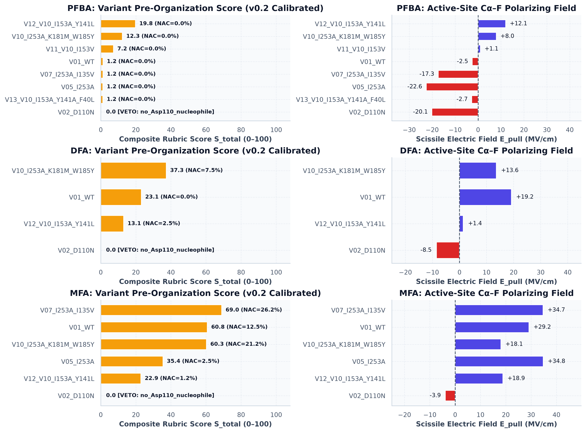
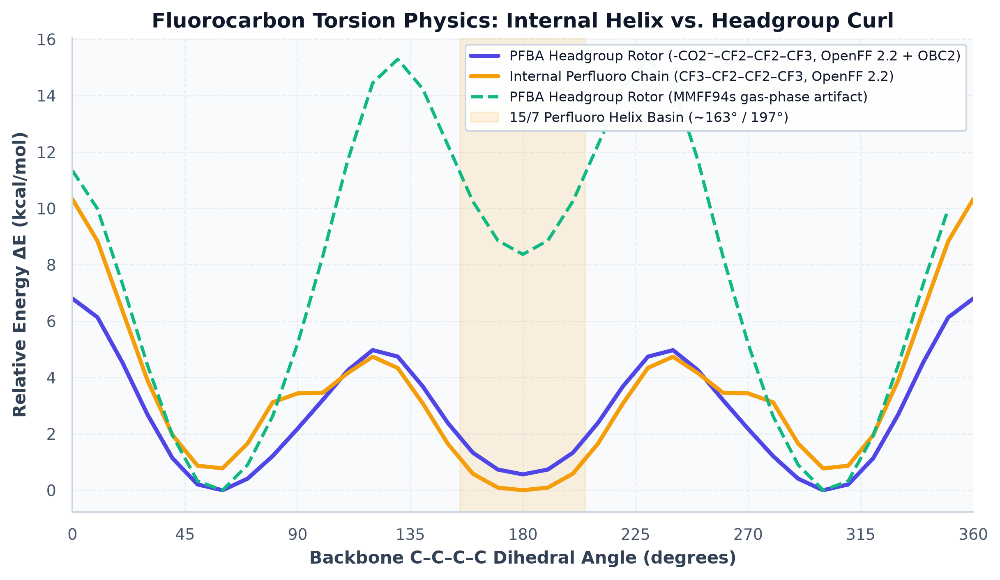

# `unpfas` (`pfas-rpa1163-defluor-bench`)

Open-source structure- and physics-guided benchmark for triaging engineered **fluoroacetate dehalogenase (`RPA1163`, *Rhodopseudomonas palustris*)** variants across a 3-step defluorination stepping-stone ladder:

1. **`MFA` ($\text{CH}_2\text{FCOO}^-$)** — Fast native positive control (calibrates wild-type $\text{S}_\text{N}2$ geometry and halide-cradle polarization).
2. **`DFA` ($\text{CHF}_2\text{COO}^-$)** — Slow experimental gem-difluoro bridge control.
3. **`PFBA` ($\text{CF}_3\text{CF}_2\text{CF}_2\text{COO}^-$)** — Short-chain ($\text{C}_4$) perfluorocarboxylate stretch target.

See [DESIGN.md](DESIGN.md) for the complete 3D crystallographic vector decomposition of `3R3V`, the 4-zone mutational rules (`Ile253` primary alcove gatekeeper along prochiral vector $\hat{v}_2$), the two-tier monomer-to-homodimer simulation funnel, and the two-stage scoring rubric ($S_{\text{total}} \in [0, 100]$).





---

## Scope, Stoichiometry & `v0.2` Calibration Notes

* **Pre-Synthesis Triage Scope & Reaction Stoichiometry**: Classical MD evaluates active-site pre-organization, halide-cradle hydrogen bonding, and scissile electric-field polarization ($\vec{E}_{\text{pull}}$); it does **not** directly compute covalent $\text{C–F}$ cleavage barriers (which require downstream hybrid QM/MM + wet-lab fluoride-ion & LC-MS product assays). Enzymatic $\text{S}_\text{N}2$ attack + hydrolytic $\alpha$-elimination on `PFBA` cleaves the **two $\alpha$-fluorines** ($\text{CF}_3\text{CF}_2\text{CF}_2\text{COO}^- \to \text{CF}_3\text{CF}_2\text{COCOO}^- + 2\,\text{F}^-$), functioning as an upper-pathway $\alpha$-defluorination activation step rather than single-enzyme complete mineralization.
* **`3R3V`-Calibrated Ground-State NAC vs. Transition-State Compression**: In the `1.56 Å` crystal structure `3R3V`, `Tyr219:OH` H-bonds to the substrate carboxylate (`2.74 Å`) in the Michaelis ground state (`3.28 Å` to `F`) prior to $\text{C–F}$ bond stretching. `p_nac_pct` evaluates ground-state Michaelis pre-organization (`d ≤ 3.45 Å`, `θ ∈ [145°, 180°]`, `≥ 1` cradle donor `≤ 2.65 Å`, clamp `≤ 3.50 Å`), while `p_ts_tight_nac_pct` tracks multi-donor transition-state-like compression (`≥ 2` donors `≤ 2.50 Å`).
* **Zero-Inflation-Free Scoring & Provenance (`v0.2`)**: Catalytically inactive controls lacking `Asp110` (`V02_D110N`) are hard-vetoed in Stage A (`S_total = 0.0`), crystal point-mutant homology models record `structure_source = crystal_3R3V_point_mutant` (`active_site_plddt = NA` unless independent AF2/Boltz-2 predictions are supplied), and every ranking table logs `total_prod_ps`, `n_frames_total`, and `top1_weight_stability_pct` across `500` $\pm 40\%$ rubric-weight perturbations.

---

## Key Physics Safeguards Baked In

* **Neural AM1-BCC Charging (`openff-gnn-am1bcc` + `OpenFF Sage 2.2.0`)**: Eliminates gas-phase `MMFF94s` intramolecular charge-dipole curling (`+8.37 kcal/mol` artifact on `PFBA`) while preserving the stiff $15_7$ perfluoroalkyl helical basin (`~163°–197°`).
* **Stereoselective `FAH 305` Template Placement + Zone-0 Torsion Sweep**: Locks $-\text{COO}^-$ in `Arg111`/`Arg114` and scissile $\text{F}$ in `His155`–`Trp156`–`Tyr219`, projects $-\text{CF}_2\text{CF}_3$ along prochiral alcove vector $\hat{v}_2$, and sweeps `C1–Cα–Cβ–Cγ` away from conserved Zone-0 residues.
* **Coordinate-Anchored Mutagenesis & Disordered Loop Closure**: Resolves mmCIF `auth_seq_id` vs. `label_seq_id` shifts via exact $\text{C}_\alpha$ coordinates, closes internal disordered loop `Gln255` in `3R3V`, and enforces catalytic histidine states (`His155=HIE`, `His280=HID` at pH 7.5; `His280=HIP` acid-stress test at pH 5.5).
* **Explicit `TIP3P-FB` + `PME` + Groundwater Matrix (`CaCl2`, `288 K` / `303 K`, pH) + Step-2 Suicide-Trap Check**: Tracks simultaneous 4-criteria NAC occupancy, PBC-aware scissile electric field ($\vec{E}_{\text{pull}}$ in MV/cm), and hydrolytic water access near `His280:NE2`/`Asp110:CG`.

---

## Quickstart (`uv`)

```bash
# 1. Sync environment & install CLI
uv sync

# 2. Run unit & explicit-solvent OpenMM integration tests
uv run pytest -v

# 3. Prepare & pre-extend anionic substrates (MFA, DFA, PFBA)
uv run pfas-bench prep-ligands --output-dir data/ligands/prepared

# 4. Audit PFBA fluorocarbon backbone torsion under OpenFF Sage 2.2.0
uv run pfas-bench torsion-audit --substrate PFBA --output-csv results/pfba_torsion_audit.csv

# 5. Run explicit-solvent (TIP3P-FB + PME) replicate(s) for WT vs. dual-alcove V07 (I253A/I135V)
uv run pfas-bench run-complex --variant V01_WT --substrate MFA --solvent explicit_tip3pfb --equil-steps 1000 --prod-steps 5000
uv run pfas-bench run-complex --variant V07_I253A_I135V --substrate PFBA --solvent explicit_tip3pfb --equil-steps 1000 --prod-steps 5000

# 6. Compute Stage-A vetoes, S_total ranking table, and diagnostic leaderboard plot
uv run pfas-bench rank --results-dir results/runs --output-csv results/summary_ranking.csv --plot-png results/summary_ranking.png
```

---

## Data Sources & Tool Attribution

* **RCSB Protein Data Bank**: PDB entries `3R3V` and `3R3U` (Chan et al., *J. Am. Chem. Soc.* 2011, 133, 7461–7468; https://www.rcsb.org/pages/usage-policy).
* **OpenMM & PDBFixer**: MIT / LGPL (Eastman et al., *PLOS Comput. Biol.* 2017).
* **OpenFF Sage (`openff-2.2.0`) & OpenFF NAGL**: MIT (Open Force Field Initiative).
* **RDKit**: BSD 3-Clause License.
